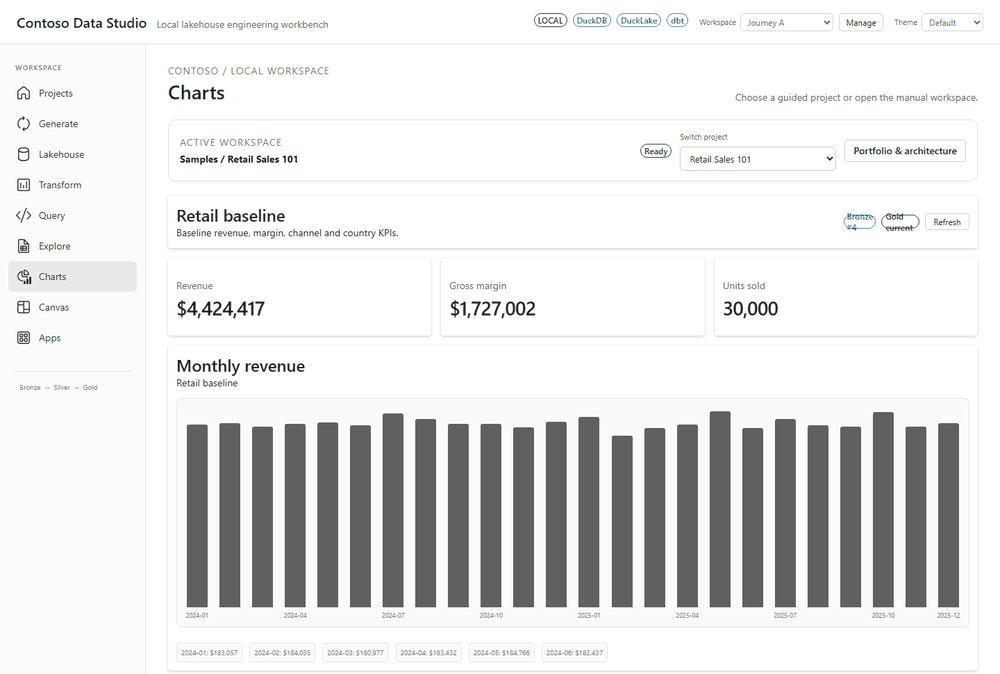
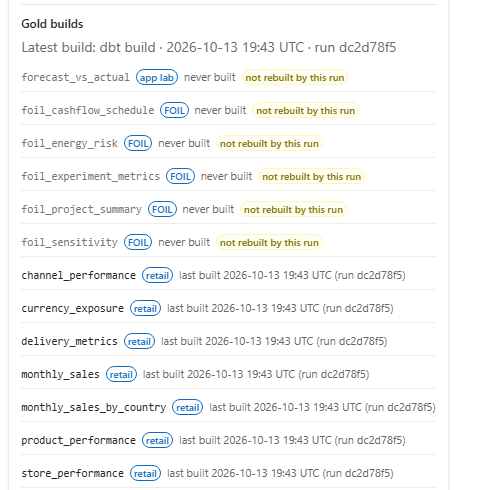
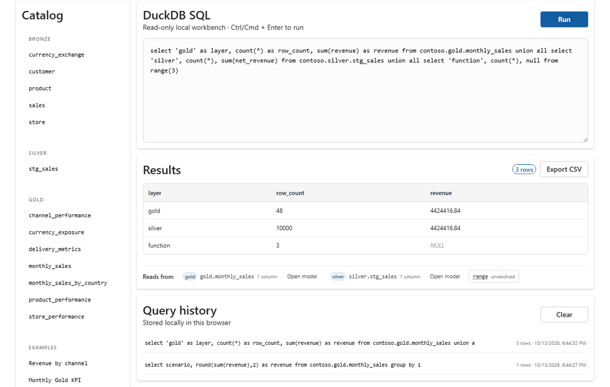
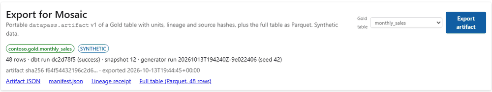
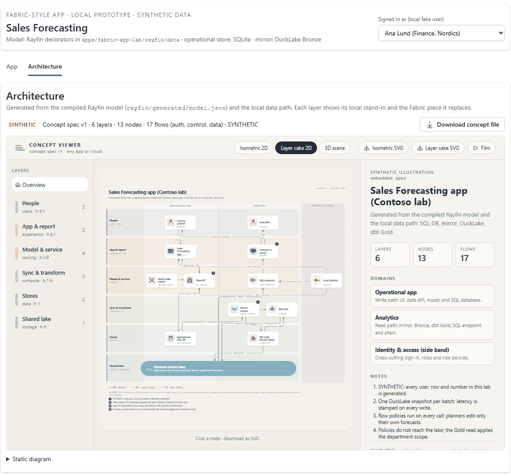
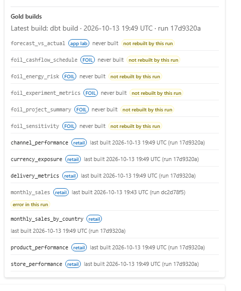
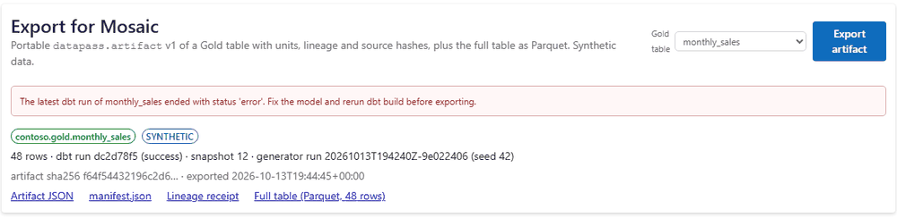
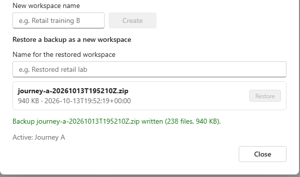

# Contoso Data Studio 0.3.0: user guide

Contoso Data Studio is a local data lab. It generates **synthetic** retail data, loads it into a local DuckLake
lakehouse (Bronze), builds Silver and Gold tables with dbt, and lets you query, chart and export the result.
Everything runs on your own computer at `127.0.0.1`; no cloud service and no real business data is used.

What changed since 0.2.0: [`docs/release/v1.md`](../release/v1.md#030-changes-since-020).

## 1. Get the package and check it

You need two files from the release: `contoso-data-studio-0.3.0-<commit>.zip` and `SHA256SUMS`. `<commit>` is the
7-character commit the package was built from; use the exact name of the file you received.

Check that the zip is intact (the printed hash must equal the one in `SHA256SUMS`):

```powershell
# Windows PowerShell
Get-FileHash contoso-data-studio-0.3.0-<commit>.zip -Algorithm SHA256
Get-Content SHA256SUMS
```

```bash
# Linux / macOS (in the folder holding both files)
sha256sum -c SHA256SUMS
```

## 2. Prerequisites

- **Python 3.12** (3.11 and later are accepted; 3.12 is what is tested).
- **No Node.js**: the web interface is already built inside the zip.
- Optional: dbt Charts (`dct`) if you want the dbt Charts board validated in Charts. Without it, Charts shows
  "dct not on PATH" and everything else works.

## 3. Install

Unpack the zip into its own folder, **outside any Git checkout** (for example `C:\Apps` or `~/apps`), and install it
into a new, empty virtual environment inside that folder. The install must stay editable (`-e`): the dbt models, the
charts and the web interface are read from the unpacked folder.

```powershell
# Windows PowerShell
Expand-Archive contoso-data-studio-0.3.0-<commit>.zip -DestinationPath C:\Apps
cd C:\Apps\contoso-data-studio-0.3.0-<commit>
py -3.12 -m venv .venv
.venv\Scripts\pip install -e "apps/api[dbt]"
```

```bash
# Linux / macOS
unzip contoso-data-studio-0.3.0-<commit>.zip -d ~/apps
cd ~/apps/contoso-data-studio-0.3.0-<commit>
python3.12 -m venv .venv
.venv/bin/pip install -e "apps/api[dbt]"
```

`.venv\Scripts\contoso-studio --version` (or `.venv/bin/contoso-studio --version`) prints `0.3.0`.

## 4. Start

```powershell
.venv\Scripts\contoso-studio --port 8000 --open      # Windows; --open also opens the browser
```

```bash
.venv/bin/contoso-studio --port 8000                 # Linux / macOS
```

The terminal prints `Contoso Data Studio on http://127.0.0.1:8000/ (project root ...)`. Open
<http://127.0.0.1:8000/> in your browser. Use another free port with `--port` if 8000 is taken. The studio only
listens on `127.0.0.1` and has no login: it is for one person on one computer.

Your data goes to the `workspace/` folder (and `workspaces/` for named workspaces and backups) inside the unpacked
folder. `contoso-studio --help` lists the variables that move it elsewhere (`CONTOSO_WORKSPACE`, `CONTOSO_HOME`).

## 5. First useful action: Retail Sales 101 from raw data to a revenue KPI

1. In the header, **Switch project** -> **Retail Sales 101** (or **Projects** -> **Retail Sales 101** ->
   **Open project**). This is the `retail-baseline` scenario. The studio then runs the whole chain by itself:
   generate the synthetic files (seed 42) -> load them into DuckLake **Bronze** -> `dbt build` for **Silver** and
   **Gold** -> data quality tests. It takes a minute or two the first time, then opens **Charts**.
2. **Charts** shows the **Revenue**, **Gross margin** and **Units sold** KPIs and the monthly revenue chart, all read
   from the Gold table `contoso.gold.monthly_sales`.

   

3. **Transform** shows the dbt lineage, the latest run and, for each Gold model, when it was last built and by which
   run. **Lakehouse** shows the Bronze, Silver and Gold tables of the DuckLake catalog. **Generate** shows the run
   (scenario, seed, file hashes).

   

## 6. Query and "Reads from"

**Query** runs read-only DuckDB SQL (statements that would change data are refused). Try:

```sql
select scenario, round(sum(revenue),2) as revenue from contoso.gold.monthly_sales group by 1
```

Under the results, **Reads from** lists the lake tables the statement really read (resolved by DuckDB), each with its
layer (bronze, silver or gold) and the columns it contributed. Click a table to open it in **Lakehouse** with that
table selected and previewed; **Open model** opens its dbt model in **Transform**. Anything DuckDB cannot resolve
(for example a table function such as `range(3)`) is shown as unresolved and is not clickable.



## 7. Export to Mosaic

- **Artifact**: **Charts** -> **Export for Mosaic** -> choose a **Gold table** (for example `monthly_sales`) ->
  **Export artifact**. The panel then offers **Artifact JSON** (`datapass.artifact` v1), `manifest.json`, the
  **Lineage receipt** (which dbt run, DuckLake snapshot and generator run produced it) and the **Full table
  (Parquet)**. The files are also written to `exports/<export id>/` inside the active workspace folder.
- **Concept**: **Apps** -> **Architecture** shows the architecture concept in the embedded viewer;
  **Download concept file** saves `contoso-sales-forecasting.concept.json`.

Open either file in Mosaic (DataPass MosaicStudio, a separate application).





## 8. Break a model and repair it

The dbt models are plain files in the unpacked folder, for example `dbt/models/gold/monthly_sales.sql`.

1. Make a mistake on purpose, for example add `where no_such_column > 0` at the end of that file, and save.
2. **Transform** -> **Build**. The **Latest run** lists `monthly_sales` with status **error** and its data tests
   as **skipped**; the full dbt message (the unknown column) is under **Console output**. In **Gold builds**,
   `monthly_sales` keeps its last good build and is marked **error in this run**: the Gold table built before stays
   as it was.

   

3. **Charts** -> **Export artifact** is refused: "The latest dbt run of monthly_sales ended with status 'error'. Fix
   the model and rerun dbt build before exporting."

   

4. Undo the change, save, **Transform** -> **Build** again. The run succeeds and exports work again; a new export
   references the new run.

## 9. Stop, restart and reopen

- **Stop**: press `Ctrl+C` in the terminal running `contoso-studio`. If the page stays open it shows "The local API is
  not reachable"; start the studio again with the same `contoso-studio` command: the banner clears by itself within
  15 s (or click **Retry**). (Up to 0.3.0 the banner named only the developer command `uvicorn ...`; with the package,
  run `contoso-studio` again instead.)
- **Restart**: run the same `contoso-studio` command from the same folder. The studio remembers the active workspace
  and reopens it with its data, Gold tables, query history and exports; nothing is regenerated.

## 10. Workspaces, backup and restore

Header **Workspace** -> **Manage** opens **Local workspaces**:

- **Create** a named workspace (each has its own catalog, runs, dbt results, exports and query history); switch with
  the **Workspace** list in the header.
- **Back up** writes a zip to `workspaces/_backups/<workspace>-<time>.zip`.
- **Restore a backup as a new workspace**: type a **Name for the restored workspace**, then **Restore** next to the
  backup. A restore always creates a new workspace and never overwrites an existing one; **Open** it to continue.



## 11. Upgrade from 0.2.0 and roll back

**Before upgrading**, start 0.2.0 one last time and **Back up** every workspace you care about. Keep the old unpacked
folder and its zip.

Install 0.3.0 into a **new folder** with a new venv (sections 1-3). To bring your data over, copy the backup zips
into the new folder's `workspaces/_backups/` (create it if needed), then **Manage** -> **Restore** each one as a new
workspace in 0.3.0. The backup format and the workspace code did not change between 0.2.0 and 0.3.0, but restoring a
0.2.0 backup in 0.3.0 was not run as a separate test for this release. Your 0.2.0 folder
is not touched, so you can still go back to it. Do not copy workspace folders by hand between installations: the
catalog records where its data files live, and a restore is what updates that path.

Rolling back:

- **Data restore is not package rollback.** Restoring a backup brings back data; it does not change the installed
  version.
- To roll back the package, reinstall the previous zip (`contoso-data-studio-0.2.0-fe83dbd.zip`) in its own folder
  and venv, or start the 0.2.0 folder you kept.
- A workspace written by a newer version is only guaranteed to open in that version or later. Opening in 0.2.0 a
  workspace that 0.3.0 has used is not tested; use the backups you made in 0.2.0 instead.

## 12. Known issues and support

| Item | Status |
| --- | --- |
| Windows 11, Python 3.12 | tested locally: retail journey (`tools/qa_retail_journey.py`) and `contoso-studio` |
| Ubuntu (CI), Python 3.12 | tested on every change: API tests, package install, browser journey |
| macOS | not tested |
| Node.js | only for development from source (Node 22 or 26); not needed for the package |
| dbt Charts board validation | needs the separate `dct` tool; shows "dct not on PATH" otherwise |
| API-down banner | names the developer command `uvicorn ...`; package users run `contoso-studio` again |
| Network access | none needed after install (pip downloads dependencies once); the first lake use may download DuckDB extensions once |
| Real data, cloud, Fabric, Power BI | not part of this product; all data is synthetic |

Problems and questions: open an issue on the GitHub repository `julian-passebecq/contoso-data-studio` with the
version (`contoso-studio --version`), your OS and Python version, and what you did.
